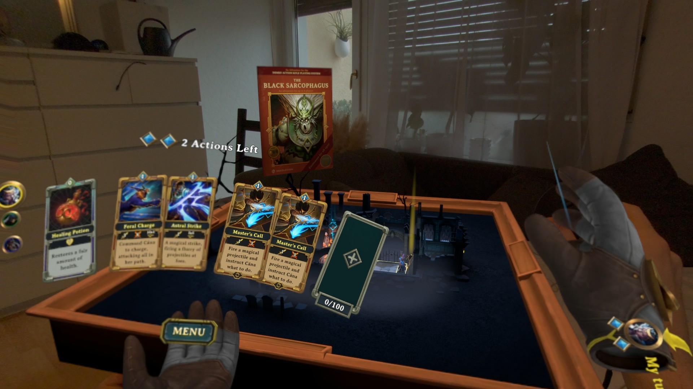

# Demeo Mixed Reality

Formerly **Demeo Green Screen**.

Enables mixed reality in the PCVR versions of Demeo, Demeo Battles and Demeo
Battlemarked. Steam Frame over Steam Link offers native passthrough like the
standalone Quest versions, without green outlines or colour-key artefacts.
Quest users on Virtual Desktop can use the original colour-key mode.

<p align="center">
  <a href="#steam-frame-passthrough">
    <picture>
      <source media="(prefers-color-scheme: dark)" srcset="docs/img/steam-frame-logo-dark.svg">
      
    </picture><br>
    <strong>Native passthrough over Steam Link</strong>
  </a>
</p>

<p align="center">
  
</p>

## Installation

Install on your **Windows PC**, in the PCVR game's folder. First, install the
matching loader:

| Game | Loader | Extract the mod ZIP into |
|---|---|---|
| Demeo | [BepInEx 5, x64 Mono](https://github.com/BepInEx/BepInEx/releases/download/v5.4.22/BepInEx_x64_5.4.22.0.zip) | `BepInEx/plugins` |
| Demeo Battles | [BepInEx 6, IL2CPP Windows x64](https://builds.bepinex.dev/projects/bepinex_be) | `BepInEx/plugins` |
| Demeo Battlemarked | [BepInEx 6, IL2CPP Windows x64](https://builds.bepinex.dev/projects/bepinex_be) | `BepInEx/plugins` |

1. Start the game once with its loader, then close it.
2. Download your game's ZIP from [Releases](https://github.com/McFredward/demeo-mixed-reality/releases) and extract it into the folder above.
3. Start the game in VR. In Demeo and Demeo Battles, turn off the basement environment in the game settings.

For automatic installation from this download, install [.NET SDK 8+](https://dotnet.microsoft.com/download/dotnet/8.0), then run PowerShell in the extracted project folder:

```powershell
.\scripts\install.ps1
```

The installer finds installed games and their loaders, builds the matching mods
and installs them. Existing configuration is preserved. It also supports
MelonLoader for all three games.

## Quest + Virtual Desktop (colour replacement)

After installing the mod on your PC:

1. Connect your Quest with **Virtual Desktop**, with its Streamer running on the PC, and start the game in VR.
2. In the [mod config](#settings), set `NativePassthrough=false` and keep the default background: **R=0, G=255, B=0**.
3. In Virtual Desktop's VR menu, enable **Streaming → VR Passthrough** and select the same green. Start with **Similarity 37** and **Smoothness 5**.

## Steam Frame passthrough

Install [Steam Link Native Passthrough](https://github.com/McFredward/steam-link-native-passthrough)
on the PC and Frame. Keep `NativePassthrough=true` in the [mod config](#settings).
Native passthrough requires Steam Frame over Steam Link. All three games have
been tested on the headset.

Steam Link can use **Auto or a fixed bitrate**. Close **OVR Advanced Settings**
while playing Demeo; it can cause unwanted recentering.

## Settings

BepInEx uses `BepInEx/config/DemeoMixedReality.cfg`. Existing
`greenscreen.ini` / `custom_color.ini` settings are imported once; your old files
are kept. MelonLoader continues to use `greenscreen.ini` beside the mod DLL.
Changes apply while the game runs.

```ini
[COLOR]
R=0
G=255
B=0

[TABLE]
Disable=true

[STEAMLINK]
NativePassthrough=true

[LOGGING]
Level=Auto
```

Use `[COLOR]` with `R`, `G`, `B` values from 0–255 to change the background colour;
select the same colour in Virtual Desktop.

Logging defaults to full diagnostics on **dev** and important messages, warnings
and errors on **main**. `Level=Debug` enables diagnostics manually;
`Important`, `Warning` and `Error` are also available.

Existing DLL filenames and `greenscreen.ini` remain compatible with earlier
GreenScreen installations.
