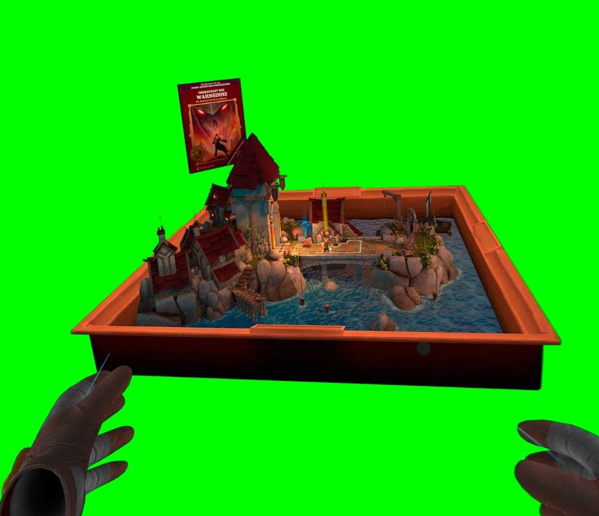
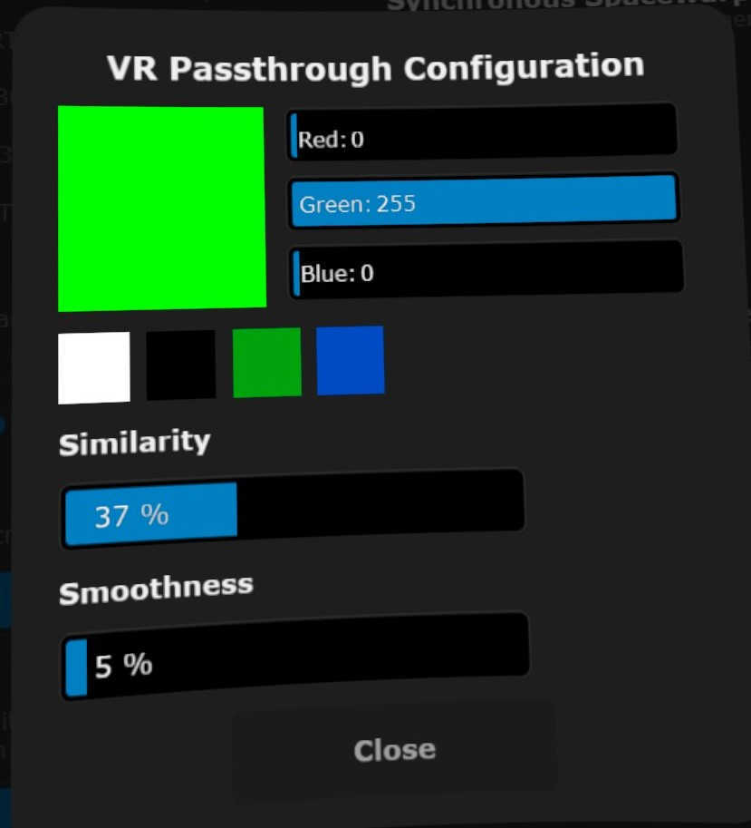

# Demeo_GreenScreen
Mixed reality for the PCVR versions of Demeo, Demeo Battles & Demeo Battlemarked. On a detected Steam Frame over Steam Link, native passthrough is enabled by default. Other headsets and transports use a background colour for [Virtual Desktop](https://www.meta.com/de-de/experiences/1261331807302580/). Native alpha integrates [Steam Link Native Passthrough](https://github.com/McFredward/steam-link-native-passthrough) for Steam Frame.

<p align="center">
  
</p>

## How To Install & Use

<ins>**Demeo**</ins> <br>
* Download [BepInEx for Mono](https://github.com/BepInEx/BepInEx/releases/download/v5.4.22/BepInEx_x64_5.4.22.0.zip) **version 5.4.22.0**, and extract the files into the game's Folder.
* Create a new file in `Demeo\BepInEx\config\BepInEx.cfg` (create that folder if necessary). Fill it with the content from [here](https://github.com/orendain/DemeoMods/blob/main/docs/BepInEx.cfg).
* Download `Demeo.zip` from [here](https://github.com/McFredward/Demeo_GreenScreen/releases) and unzip the file into `Demeo\BepInEx\plugins`.
* Start the game & turn off the basement environment in the setting ingame.

<ins>**Demeo Battles**</ins> <br>

* Download [BepInEx for Il2CPP](https://builds.bepinex.dev/projects/bepinex_be) **version 6 Bleeding Edge, IL2CPP Windows (x64)**, and extract the files into the game's Folder.
* Download `DemeoBattles.zip` from [here](https://github.com/McFredward/Demeo_GreenScreen/releases) and unzip the file into `Demeo Battles\BepInEx\plugins`.
* Start the game & turn off the basement environment in the setting ingame.

<ins>**Demeo Battlemarked**</ins> <br>
The prebuilt Battlemarked ZIP targets **MelonLoader**. The source installer below also supports an existing BepInEx IL2CPP installation.

* Download [MelonLoader Installer](https://lemonloader.com/melonloader/) and install it for Demeo Battlemarked. **Make sure to enable nightly builds!**
* Download `DemeoBattlemarked.zip` from [here](https://github.com/McFredward/Demeo_GreenScreen/releases) and unzip the file into `Battlemarked\Mods`.
* Start the game.
  
<ins>**Demeo, Demeo Battles, Demeo Battlemarked**</ins> <br>

The following colour-key settings apply to **Virtual Desktop**. For Steam Link, use the optional mode below.

* Turn on "VR Passthrough" under the "Streaming"-Tab in the Virtual Desktop Menu (within VR).
* **USE THE FOLLOWING CONFIGURATION:**:

Red: 0, Green: 255, Blue: 0, Similarity: 37, Smoothness: 5
<p align="center">
  
</p>

## Additional Settings
* The ZIP includes `greenscreen.ini` beside the mod DLL. Edit it to customize the settings:

```ini
[COLOR]
R=0
G=255
B=0

[TABLE]
Disable=false

[STEAMLINK]
NativePassthrough=true
```

The `[TABLE]` section is only relevant for Battlemarked - this way you can re-enable the table mesh (per default its disabled).
Feel free to adjust the `[COLOR]` values as desired, ensuring they stay within the range of 0 to 255 for each component. <br>
Additionally, please update the color in the VirtualDesktop configuration accordingly. <br>
If you discover a color or configuration that, in your opinion, performs better than the default green, let me know :)

### Automatic native Steam Link passthrough

This integration is experimental and needs an in-headset test for each game. It sends the game's ordinary RGB image with independent alpha; green game objects are not removed by a colour key.

1. Install the mod for your game as above. Demeo and Battles still need the basement environment disabled in the game settings.
2. Install matching PC and Steam Frame companions using the [Steam Link Native Passthrough installer](https://github.com/McFredward/steam-link-native-passthrough#installation). Its supported hardware/runtime requirements apply.
3. Keep the included `greenscreen.ini` beside the mod DLL. Its shipped setting is:

   ```ini
   [STEAMLINK]
   NativePassthrough=true
   ```

4. Start the game in VR over Steam Link with Direct3D 11. Check both eyes, menus, loading transitions, translucent effects and reconnects on the headset.

Changing `NativePassthrough` or `[COLOR]` in the INI takes effect within about one second. Set `NativePassthrough=false` to return to Virtual Desktop's colour-key mode. `custom_color.ini`, unsectioned RGB values, and a config in the loader's plugins/Mods root remain supported; `greenscreen.ini` beside the DLL takes priority.

Native passthrough activates only when the running headset is identified as Steam Frame connected through Steam Link. While identity is still being checked, the background stays opaque black so green cannot flash during startup. A confirmed other headset, Virtual Desktop or unsupported platform uses the colour-key background even with `NativePassthrough=true`. Detection uses the same isolated public OpenVR background reader as GloomhavenVR, with periodic rechecks and immediate invalidation on HMD device changes.

After installation, the script prints the active INI path. New configs default to `NativePassthrough=true`; existing configs retain their setting. At game startup the mod logs the selected INI path, `NativePassthrough` value, and whether its Unity update callback is running. The loader's plugins/Mods root is resolved from the loader API rather than the process working directory.

The native mode waits for a verified, live sender connection before enabling transparency. Missing companions, unsupported eye buffers or lost permission leave an opaque black background, with the reason in the mod log. Installation and a successful source handshake do not prove a correct headset picture.

Version 1.4.11 retains Demeo and Battles' original **single-pass stereo rendering** and copies each completed eye slice into a separate **2D texture immediately before OpenVR Submit**. It bypasses SteamVR's optional supersample filter **only while the current thread executes an admitted native eye Submit**, preserving coverage through the intermediate OpenVR copy. It leases the public settings interface without calling any setting writer; other queries, threads and games keep their original behavior. The maintainer confirmed correct opacity and matching eyes in Demeo. The maintainer confirmed that PC patch 0.2.14 removes the intermittent flashes and that both eyes show correctly opaque objects. The remaining short black intro/loading transitions are separate game fades and source switches. The [latest continuity review](docs/STEAM-LINK-INTEGRATION.md#october21-confirmed-pc-continuity-and-native-game-fades-1412) records the evidence and limits. Rendering resolution, cameras, FOV and tracking remain unchanged. The maintainer has also confirmed Battles1.4.18's Intro, both eyes and stability. Battlemarked still requires its own headset validation.

The companion's **PC0.2.16 / Frame0.2.13** candidate on `dev` recognizes the
required native interfaces after SteamVR updates. Successfully tested runtimes
are **PC SteamVR2.17.10** and **Frame SteamVR2.18.2**; these are test observations,
not version limits. The supplied PC2.18.4 driver passes software discovery, but
its new headset test is still pending. An untested build shows an overridable
warning; accepting it enables the patch for testing. See the companion's
[update recognition and evidence](https://github.com/McFredward/steam-link-native-passthrough/blob/dev/docs/development/NATIVE-UPDATE-RECOGNITION.md).
To update the companion, run its development installer on the gaming PC:

```powershell
irm https://raw.githubusercontent.com/McFredward/steam-link-native-passthrough/dev/get.ps1 | iex
```

This candidate changes the Frame component as well, so this update requires its
coordinated update. Future updates that change only the PC component leave Frame
files, settings and services untouched and do not restart it. PC SteamVR stays
closed after setup. The game mod remains1.4.21; no game DLL rebuild is needed for
this companion update.

Version **1.4.12** changes the identified game black fades into fades toward passthrough in **all three games**, while native mode is active. The game keeps its original fade timing, loading state and completion callbacks. Opting out, losing permission or unloading restores the game materials. This is a mod update; matching PC0.2.14/Frame0.2.12 companions need no update. Actual pauses where the game submits no supported eye image remain a separate limitation. Demeo's camera/Intro fades and Battles' Intro have since been confirmed; the additional loading-canvas correction below still needs a headset check. Battlemarked remains untested.

Version **1.4.15** corrects the Demeo recenter gate: the game interface can report an emulated Quest2 while the isolated reader identifies the actual Frame. A current independent Frame/Steam Link result now takes priority. It also suppresses Demeo's automatic camera viewpoint adjustment and tracking-notification reframe in native mode, and guards the legacy automatic avatar-initialization recenter without skipping its other setup work. Controller/keyboard/Frame manual recenter and game bounds recovery remain available. Other game-owned avatar placements receive bounded timestamp/caller diagnostics. Before Frame identity is confirmed, unverified startup calls retain game behavior. These changes apply to Demeo only; both companion patches and Gloomhaven are unchanged. The maintainer confirmed a clean Demeo1.4.15 run; logs show all three suppressed automatic calls and no later origin reset or runtime stream/decoder restart.

Version **1.4.14** covers the Intro Timeline's two separate `invert_sphere` fades. Their owned material copies retain the original URP shader, animation, geometry and timing; only blend factors change so black fades reveal passthrough. The maintainer confirmed that Demeo's black transition before its logo is gone. Battles' Intro has since been confirmed with1.4.18; Battlemarked still needs its own hardware check.

The earlier1.4.14 capture contains a separate real stream failure at **16:23:54–56**: FEC recovery aborts, the decoder resets and the Frame pauses its passthrough cameras for about two seconds. It did not recur in the clean1.4.15 run, but permanent recovery from that packet-loss failure remains unproven. The [capture review](docs/STEAM-LINK-INTEGRATION.md#october21-1623-capture-game-space-reframing-and-real-stream-loss-1415) separates this event from game fades and the unassigned gameplay recenter.

Version **1.4.16** ports Demeo's automatic viewpoint and tracking-notification reframe guards to **Demeo Battles** with IL2CPP method prefixes. It uses the independently confirmed Frame/Steam Link identity and the active OpenVR game transport. Manual recenter, bounds recovery and avatar initialization callbacks remain available. Native IL2CPP constructor/avatar/rig bodies are not rewritten through their generated wrappers. Battles' other avatar placements are timestamped for the next test.

Battlemarked uses a different OpenXR camera implementation. Its existing native coverage and presenter fades already include the common corrections. Version1.4.16 observes its actual `Jade.XRRecentering` notification while preserving user recenter/listener callbacks and required scene placement. It does not apply Battles' camera-method suppression to unrelated Battlemarked methods. Battles1.4.18 has since passed its Intro/stereo test; **test its1.4.20 scenario-loading transition and menu recenter guard next**. Battlemarked still needs its first headset check.

Version **1.4.17** fixes the IL2CPP shader-loading boundary used by Battles and Battlemarked. The Battles1.4.16 test recognized Frame/Steam Link, but failed to prepare the coverage shader with `ObjectCollectedException`, leaving native passthrough inactive. Both owned bundles now use checked Unity6 native byte/UTF16 spans and resolve the returned Unity GC handles before creating rooted bundle/shader wrappers. Demeo keeps its original Mono public API calls. Shader contents, rendering settings, companions and Gloomhaven are unchanged. Native fixture and six-build checks pass; **retest Demeo Battles** to verify the actual Unity/headset outcome. See the [shader-loading review](docs/STEAM-LINK-INTEGRATION.md#battles-black-passthrough-unity6-il2cpp-shader-loading-1417).

Version **1.4.18** addresses the Battles1.4.17 crash and black Intro. The optional Unity GPU alpha probe is omitted from both IL2CPP builds because their generated `XRRenderParameter` output binding writes a native value structure into pointer-sized storage. Coverage repair and native exact-submit statistics remain active; Demeo retains its Mono probe. Cameras without additional URP data now use the active asset's actual default renderer, matching Unity and Battles' supplied Intro scene. Explicit unsupported renderers remain refused. **The maintainer confirmed that the Intro, both headset eyes and stability now work.** The remaining black scenario-loading transition is investigated in1.4.19/1.4.20 below. No companion update or Frame restart is required. See the [crash/Intro review](docs/STEAM-LINK-INTEGRATION.md#battles-crash-and-black-intro-1418).

Version **1.4.19** makes the separately rendered black loading-canvas `Background` transparent during admitted native passthrough in Demeo and Battles. The equivalent Demeo Vanilla and Battles PVP prefabs were both checked. It retains loading callbacks, input blocking, hint text, spinner and artwork, and restores the current original colour on opt-out/unload. It also removes our global Harmony type search and fixes the stale loader version label. **The subsequent Battles headset test still showed a fully black loading transition; the logs did not confirm application of the UI correction.** See the [loading/fade audit](docs/STEAM-LINK-INTEGRATION.md#loading-canvas-audit-and-errorlog-1419).

Version **1.4.20** captures Demeo/Battles camera fades directly on the admitted XR camera, including fades without observed update callbacks. Demeo also observes original controller construction. For reused views, Demeo restores the original material before construction; Battles redirects an exactly identified cached replacement back to its original animation material before the game writes, without detouring an allocating IL2CPP constructor wrapper. Battles additionally guards the legacy `InputTracking.Recenter` only inside automatic avatar initialization on verified Frame/OpenVR passthrough; other initialization, manual recenter, other threads and other transports keep their behavior. The latest logs correlate a Standing-origin change with avatar initialization; they do not prove the exact native caller. Source-status messages now include timestamps to separate late texture switches from game exit. This is a tested software correction awaiting headset confirmation. PC0.2.14, Frame0.2.12 and Gloomhaven remain unchanged; no Frame update/restart is needed. The latest ErrorLog adds a Steam networking socket-cleanup warning at exit, without the previous access violation. See the [1.4.20 evidence and test limits](docs/STEAM-LINK-INTEGRATION.md#battles-loading-camera-and-scoped-avatar-reset-1420).

Version **1.4.21** requests metadata bandwidth accounting from **PC patch0.2.15**. The1.4.20 Battles test confirms that the loading fades are gone and the recenter guard executes. Its remaining blackout follows unrecoverable native packet loss and a decoder restart. Coverage metadata added about33% to that run's original video volume. The new PC policy reserves measured metadata traffic inside the requested video bitrate; it can increase video compression while retaining resolution, frame rate and lossless masks. Set `[STEAMLINK] AccountMaskBandwidth=false` to use the original policy. Older PC companions fall back to the existing protocol. Current GloomhavenVR continues using its unchanged v1 policy; Frame0.2.12 needs no update/restart. This addresses a reproduced bandwidth-budget defect; an extended headset test must establish whether the observed blackout recurs. See the [packet-loss review](docs/STEAM-LINK-INTEGRATION.md#battles-packet-loss-and-producer-wire-budget-1421).

Actual Unity tracking-origin notifications mark the following two admitted OpenVR eye pairs with `Submit_FrameDiscontinuity`, preventing motion smoothing from extrapolating across a coordinate change. Version1.4.16 also supports the supplied IL2CPP callback signatures. This observation never changes the origin and is inactive for Battlemarked's normal OpenXR output. The separate-eye adapter requires a confirmed Frame / Steam Link connection, a live source grant and the pinned SDK. The failed1.4.6 MultiPass transition remains removed. PC0.2.14/Frame0.2.12 companions and Gloomhaven are unchanged; no companion update or Frame restart is needed for1.4.16.

For Unity 6 URP Forward/Forward+, the mod temporarily enables alpha processing and preserves alpha in HDR intermediates when needed. An embedded stereo shader repairs opaque-object alpha using each eye's current depth before transparent effects are drawn. Game post-processing is temporarily bypassed because released games can have its alpha shader variants stripped. It keeps Linear project lighting and Unity's normal sRGB output. These settings are restored on opt-out or unload. Eye resolution, MSAA and field of view are retained. The separate-eye submission path has an actual-SDK/D3D11 regression test; visual confirmation on the headset is still required. See [integration details and validation limits](docs/STEAM-LINK-INTEGRATION.md).

## Build and install automatically (Windows)

Install BepInEx or MelonLoader first and start each IL2CPP game once so its interop assemblies are generated. Install the **.NET SDK 8 or newer**, clone this repository, close the games, and run from PowerShell:

```powershell
.\scripts\install.ps1
```

The script finds all three games through Steam's registry entry, `libraryfolders.vdf` and app manifests, builds against each game's actual local assemblies, and copies its mod DLL into `BepInEx/plugins` or `Mods`. It checks for a `BepInEx` folder first for every game, including Battlemarked, and otherwise detects MelonLoader. Both loaders have matching mod entry points for all three games. Existing nested plugin locations and config files are retained; the previous DLL is saved as `.dll.bak`.

```powershell
.\scripts\install.ps1 -ListOnly
.\scripts\install.ps1 -WhatIf
.\scripts\install.ps1 -Game Demeo
.\scripts\install.ps1 -Game DemeoBattles -GamePath "D:\SteamLibrary\steamapps\common\Demeo Battles"
.\scripts\install.ps1 -SteamLibrary "D:\SteamLibrary"
.\scripts\install.ps1 -Game DemeoBattlemarked -Loader BepInEx
.\scripts\install.ps1 -Loader MelonLoader
```

`-Loader` overrides automatic detection when needed. BepInEx uses `core` and, for IL2CPP, `interop`; MelonLoader uses `net35`/`net472` for Mono or `net6` plus `Il2CppAssemblies` for IL2CPP. An incomplete BepInEx folder reports the missing DLL instead of silently selecting another loader.

The installer preflights every selected game before installing anything. A missing loader/interop directory or a running game stops installation; a failed build leaves that game's installed DLL intact. It does not install the separate Steam Frame companion.

## Building

Build each configuration against that game's installed loader and managed/interop assemblies:

```sh
dotnet build GreenScreen.csproj -c DEMEO -p:GameDirectory="C:/Games/Demeo"
dotnet build GreenScreen.csproj -c DEMEOBATTLES -p:GameDirectory="C:/Games/Demeo Battles"
dotnet build GreenScreen.csproj -c DEMEOBATTLEMARKED -p:GameDirectory="C:/Games/Battlemarked"
```

Use `-p:LoaderBackend=BepInEx` or `-p:LoaderBackend=MelonLoader` to select a loader explicitly. `UnityAssemblyDirectory` and `LoaderDirectory` can override the reference locations independently. Loader and game assemblies are not copied into the output. The coverage shader is embedded in the mod DLL; rebuilding it requires Unity 2021.3 with Windows build support and the project's enabled AssetBundle module (see `unity/Assets/Editor/BuildCoverage.cs`). The build verifies native loading of the resulting bundle and its Shader asset.

### CI builds without an installed game

Development happens on `dev`. CI checks `dev`/`main` pushes and pull requests. Every push to `main` builds `Demeo.zip`, `DemeoBattles.zip` and `DemeoBattlemarked.zip`, available together with checksums in the workflow's **Demeo-mods** artifact. The workflow does not push commits or create releases.

CI uses committed [metadata-only references](libs/RefAsm/README.md). Every method body is removed, and CI verifies that all MethodDef RVAs are zero. Public loader dependencies are downloaded from SHA-256-pinned archives. CI compiles and checks both loader variants for each game; the three ZIPs retain their documented defaults (BepInEx for Demeo/Battles, MelonLoader for Battlemarked). The local installer builds the variant detected on your PC. ZIP packaging allows only the mod DLL, active `greenscreen.ini`, README and licences. The mod embeds a small owned identity reader and Valve's pinned public OpenVR SDK loader; game assemblies and mod loader assemblies are excluded.

CI also validates the coverage bundle's asset directory, its shader reference, D3D11 programs and named passes. It rejects the malformed 1.4.1 bundle as a regression fixture and checks that all six DLLs embed the exact validated bytes. Packaging requires the Python dependencies pinned in `scripts/coverage-requirements.txt`; these build tools are excluded from the ZIPs.

Run the same package build locally without a game installation:

```sh
python3 scripts/fetch-build-deps.py
python3 scripts/package.py
```

See [CI and installation details](docs/BUILD-AND-INSTALL.md) for reference regeneration and checks.

## Known issues

* Visible outlines around some objects (Depends on your passthrough configuration in Virtual Desktop)
* You can look through some parts of some objects which also have the same color (e.g. the Swiftness Potion Card for the default green background).

## Credits & Libs

* Code inspired by "SkipIntro" from [DemeoMods by orendain](https://github.com/orendain/DemeoMods) using the MIT License
* [HarmonyLib](https://github.com/pardeike/Harmony) using the MIT License
* [BepInEx](https://github.com/BepInEx/BepInEx) using the LGPL2.1 license
* [MelonLoader](https://github.com/LavaGang/MelonLoader) using the Apache-2.0
* [Steam Link Native Passthrough](https://github.com/McFredward/steam-link-native-passthrough) for the paired PC/Frame companion and application source protocol
* [GloomhavenVR](https://github.com/McFredward/GloomhavenVR) for the headset identity reader, source-negotiation client and opaque-depth coverage approach (GPL-3.0)
* [Valve OpenVR SDK](https://github.com/ValveSoftware/openvr) 1.26.7 (BSD-3-Clause); bundled licence in `licenses/OpenVR-LICENSE.txt`

If you have any suggestions, feel free to open an Issue. Or contact me (McFredward) in via Discord.

